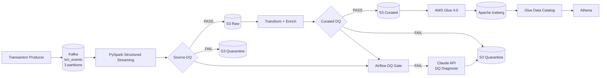
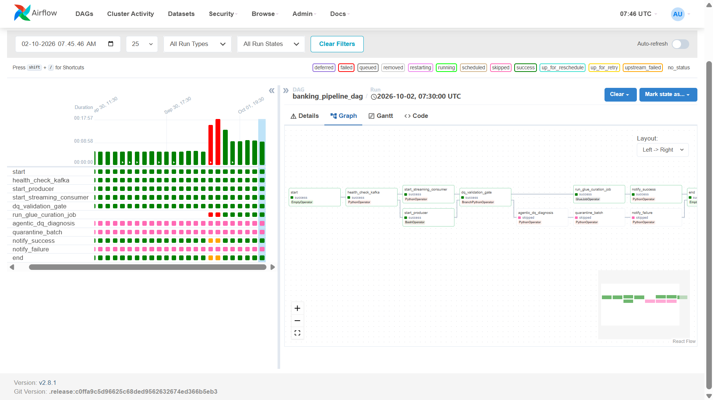
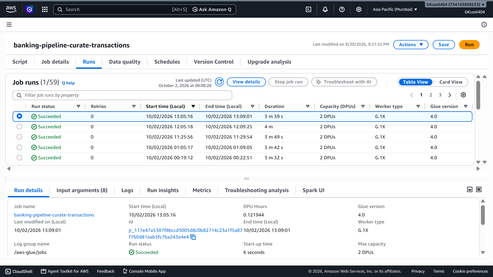
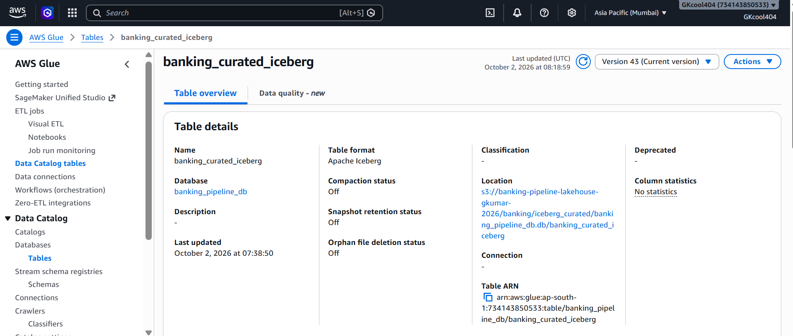
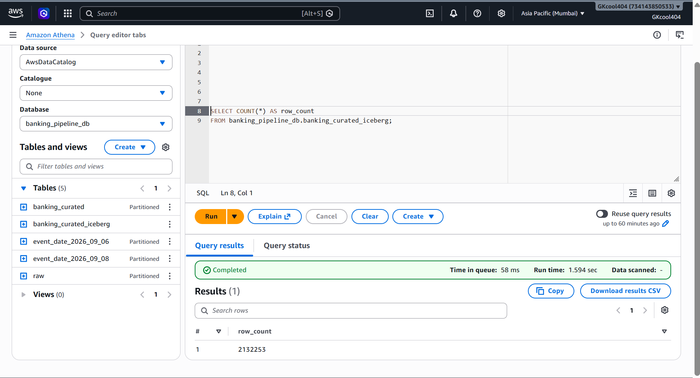
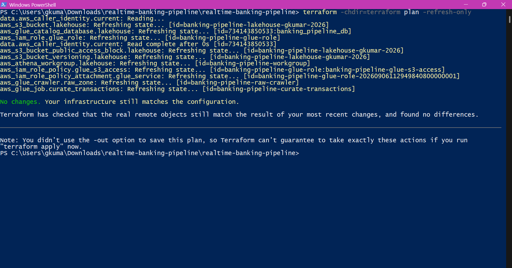
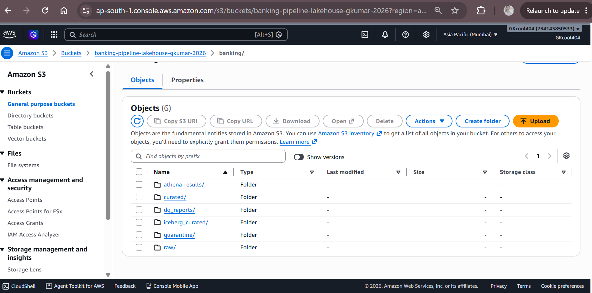
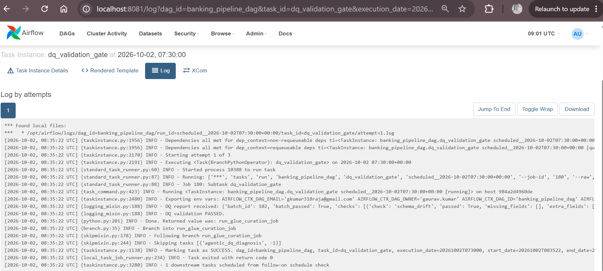
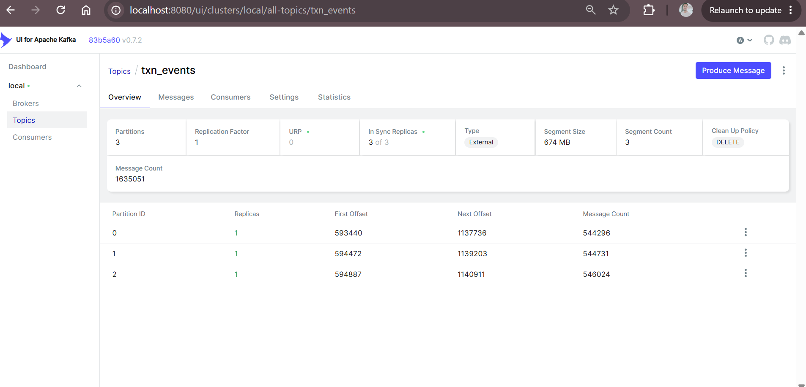
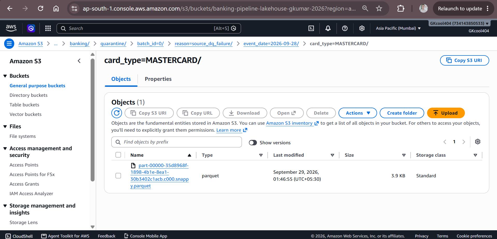

# 🏦 Real-Time Banking Lakehouse

### Kafka → PySpark → S3 → Data Quality → Airflow → AWS Glue → Apache Iceberg → Athena


> Production-style portfolio project for real-time banking data engineering, combining streaming ingestion, automated data-quality gates, AWS lakehouse curation, quarantine handling, and LLM-assisted DQ diagnosis.

---

## ✨ What it demonstrates

| Area | Implementation |
|---|---|
| Streaming | Kafka + PySpark Structured Streaming |
| Data Quality | Schema, null, duplicate, domain, timestamp, business-rule & anomaly checks |
| Orchestration | Apache Airflow + LocalExecutor |
| Lakehouse | S3 + Apache Iceberg + Glue Data Catalog |
| Analytics | Amazon Athena |
| Cloud / IaC | AWS + Terraform |
| AI-assisted DQ | Claude API diagnosis layer |

---

## 🏗️ Architecture



---

## 🔄 End-to-End Flow

```text
Kafka Event
    ↓
PySpark Streaming
    ↓
Source DQ
    ├── FAIL → Quarantine
    └── PASS
           ↓
       S3 Raw
           ↓
    Transform + Enrich
           ↓
      Curated DQ
       ├── FAIL → Quarantine
       └── PASS
              ↓
          AWS Glue
              ↓
       Apache Iceberg
              ↓
       Glue Data Catalog
              ↓
           Athena
```

---

## 🤖 Claude-powered DQ Diagnosis

The DQ failure path includes an **implemented Claude API diagnosis component**.

It converts structured DQ failures into a machine-readable diagnosis:

```json
{
  "likely_cause": "Upstream timestamp validation failure",
  "confidence": 0.91,
  "suggested_action": "Inspect source timestamp mapping",
  "is_actionable_now": true
}
```

**Design principle:** Claude is used for diagnosis and recommendations; data quarantine and pipeline control remain deterministic.

> The integration is implemented in the repository. A final live API smoke test can be completed separately with valid Anthropic credits/credentials.

---

## 🛡️ Data Quality

The pipeline checks the data before curated publication:

- Schema drift
- Null-rate thresholds
- Duplicate transactions
- Domain / business rules
- Amount validity
- Timestamp validity
- Curated schema
- Curated business rules
- Statistical anomaly detection

DQ results are passed to Airflow so the DAG can branch on the **actual validation result**.

---

## 📸 Live Project Evidence

### Airflow — End-to-End Pipeline



### AWS Glue — Successful Curation



### Glue Data Catalog — Apache Iceberg



### Athena — Curated Iceberg Query



### Terraform — Infrastructure Validation



### S3 — Lakehouse Layout



### Airflow — DQ Validation Gate



### Kafka — `txn_events`



### Quarantine — DQ Failure Evidence



---

## 📊 Validated Demo Snapshot

| Metric | Demonstrated |
|---|---:|
| Kafka partitions | **3** |
| Curated Iceberg records queried | **2.13M+** |
| AWS Glue version | **4.0** |
| Curated table | **`banking_curated_iceberg`** |
| DQ categories | **9+** |
| Quarantine path | **Verified in S3** |
| Infrastructure drift | **None at final Terraform validation** |

---

## 🛠️ Technology Stack

| Layer | Technology |
|---|---|
| Ingestion | Apache Kafka |
| Processing | PySpark Structured Streaming |
| Storage | Amazon S3 |
| DQ | Custom PySpark DQ framework |
| Orchestration | Apache Airflow |
| Cloud Curation | AWS Glue 4.0 |
| Table Format | Apache Iceberg |
| Metadata | AWS Glue Data Catalog |
| Query | Amazon Athena |
| Infrastructure | Terraform |
| Runtime | Docker / Docker Compose |
| AI-assisted diagnosis | Claude API |
| Testing | Pytest |

---

## ☁️ AWS Resources

```text
Region
└── ap-south-1

S3
├── raw
├── curated
├── dq_reports
├── quarantine
├── iceberg_curated
└── athena-results

Glue
├── banking_pipeline_db
├── banking-pipeline-curate-transactions
└── banking_curated_iceberg

Athena
└── banking-pipeline-workgroup
```

---

## 📁 Project Structure

```text
realtime-banking-lakehouse/
├── producer/
├── consumer/
├── dq/
├── dags/
├── glue_jobs/
├── storage/
├── config/
├── terraform/
├── tests/
├── docs/
│   └── screenshots/
├── Dockerfile.spark
├── docker-compose.yml
├── docker-compose.airflow.yml
├── requirements.txt
├── requirements.spark.txt
├── .env.example
└── README.md
```

---

## ▶️ Run Locally

### 1. Start Kafka / Spark

```powershell
docker compose -f docker-compose.yml up -d
```

### 2. Start Airflow / PostgreSQL

```powershell
docker compose -f docker-compose.airflow.yml up -d
```

### 3. Validate containers

```powershell
docker ps
```

### 4. Trigger the DAG

```powershell
docker exec airflow airflow dags trigger banking_pipeline_dag
```

### 5. Run tests

```powershell
pytest -q
```

---

## 🏗️ Terraform

```powershell
terraform -chdir=terraform init
terraform -chdir=terraform validate
terraform -chdir=terraform plan
```

Apply only after reviewing the plan:

```powershell
terraform -chdir=terraform apply
```

Secrets and Terraform state are intentionally excluded from Git.

---

## 🎯 Key Engineering Decisions

**Kafka** — durable partitioned event ingestion and producer/consumer decoupling.

**PySpark Structured Streaming** — distributed processing with Spark-native streaming, transformations and AWS storage integration.

**S3 + Iceberg** — durable object storage plus an analytical table abstraction.

**Airflow** — dependency-aware orchestration and explicit PASS/FAIL branching.

**Quarantine** — isolates failed batches instead of silently publishing bad data.

**Claude** — assists engineers with DQ root-cause diagnosis while deterministic pipeline logic controls publication and quarantine.

---

## ✅ Project Status

| Capability | Status |
|---|---|
| Kafka ingestion | ✅ Implemented |
| PySpark streaming | ✅ Implemented |
| S3 raw / curated zones | ✅ Implemented |
| Automated DQ | ✅ Implemented |
| Airflow orchestration | ✅ Implemented |
| AWS Glue curation | ✅ Implemented |
| Apache Iceberg | ✅ Implemented |
| Glue Data Catalog | ✅ Implemented |
| Athena analytics | ✅ Implemented |
| Quarantine workflow | ✅ Implemented |
| Terraform IaC | ✅ Implemented |
| Tests | ✅ Included |
| Claude DQ diagnosis | ✅ Implemented |
| Live Claude API smoke test | ⏳ Final external validation |

---

## 🔐 Security

Never commit:

```text
.env
AWS credentials
Anthropic API keys
Terraform state / backups
local databases
private credentials
```

Use `.env.example` as the safe configuration template.

---

## 👤 Author

**Gaurav Kumar**
Data Engineer | IIT Kharagpur

[](https://linkedin.com/in/gaurav-kumar-999710188)
[](https://github.com/kingcoolgk)

---

### Repository

**https://github.com/kingcoolgk/realtime-banking-lakehouse**
